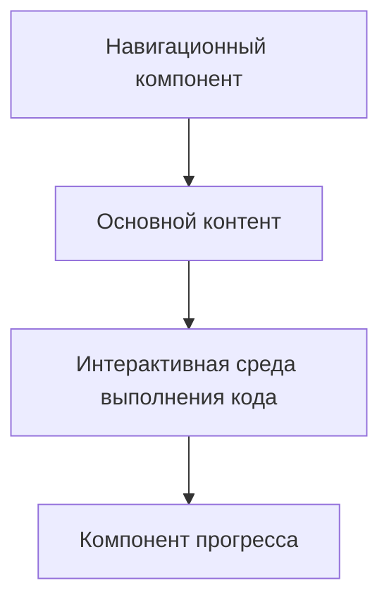

# Архитектурный план проекта аналога freeCodeCamp

## Основные компоненты проекта:
1. **Навигационный интерфейс** - Переключение между уроками
2. **Платформа для упражнений** - Выполнение задач и проверка кода
3. **Интерактивная среда выполнения кода** - Исполнение Python кода в браузере
4. **Учебные материалы** - Лекции и примеры кода
5. **Система отслеживания прогресса** - Сохранение данных о выполненных уроках

## Структура файлов:
- `index.html` - Основной файл проекта, содержащий HTML, CSS и JavaScript

## Архитектура компонентов:

## Пошаговый план реализации:
1. Создать базовую структуру HTML
2. Реализовать навигационный компонент
3. Добавить учебные материалы
4. Интегрировать среду выполнения кода
5. Реализовать отслеживание прогресса
6. Оформить стили и адаптивность
